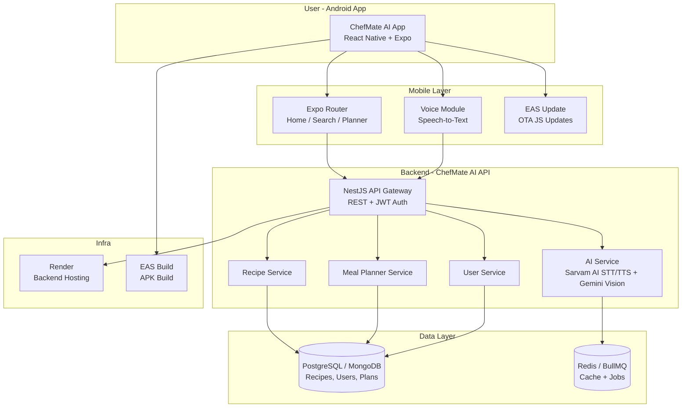

# ChefMate AI

AI-powered kitchen assistant that helps you decide what to cook, how to cook it, and what to buy — using what you already have in your fridge.

## Demo

**Android APK / Demo:**
https://drive.google.com/file/d/1OnaKnQeVr71kiJhBKmWx9dtOCCgKC_7c/view?usp=drivesdk

> Download the APK from the link above and install it on your Android device to test the app.

---

## Tech Stack

### Frontend — Mobile App
- **React Native** with **Expo (EAS Build)**
- **Expo Router** — File-based navigation
- **TypeScript**
- **Expo Speech / Voice** — Voice-based recipe search
- **Expo Updates (OTA)** — Over-the-air updates for JS changes

### Backend — ChefMate AI API
- **NestJS** (Node.js + TypeScript)
- **Express.js** under the hood via NestJS
- **REST APIs**
- **PostgreSQL / MongoDB** — Recipes, users, meal plans
- **Redis / BullMQ** — Background jobs / caching
- **JWT Auth** — Secure login

### AI / Services
- **Sarvam AI** — Speech-to-Text (STT) & Text-to-Speech (TTS) for voice recipe search in English + Hindi / Hinglish
- **Google Gemini** — AI Vision + Recipe generation, ingredient detection from photos, substitutions & diet adaptation
- **LLM Integration** — Recipe generation, substitutions, diet adaptation

### DevOps / Tools
- **EAS Build** — Android APK / AAB builds
- **EAS Update** — OTA updates on `preview` branch
- **Render** — Backend deployment
- **GitHub** — Version control

---

## Features

- **Voice Recipe Search** — Ask “Mujhe paneer ki recipe batao” and get instant recipes
- **Fridge to Recipe** — Enter ingredients you have, get recipes you can cook now
- **AI Recipe Generator** — Personalized recipes by diet (Veg / Jain / High Protein / Low Calorie)
- **Meal Planner** — Plan week, auto-generate grocery list
- **Step-by-Step Cooking Mode** — Clean, distraction-free cooking view
- **Smart Substitutions** — Missing ingredient? Get instant replacement

---

## Architecture Diagram



### How it works — Simple Flow

```
User (Voice / Text) 
  -> React Native App (Expo)
  -> NestJS API (JWT Auth)
  -> AI Service (LLM) + Recipe DB
  -> Response (Recipe + Steps + Grocery List)
  -> App UI
```

---

Built by Zuhair Khan
